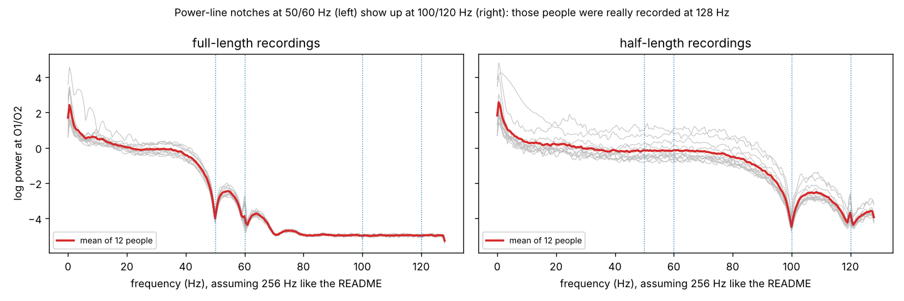
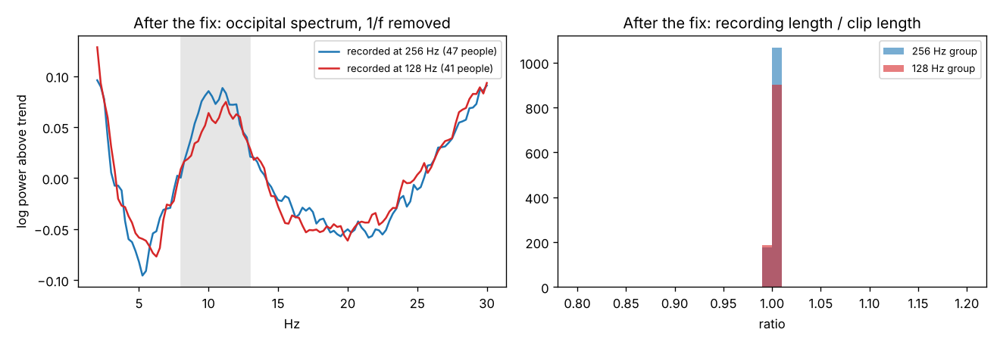
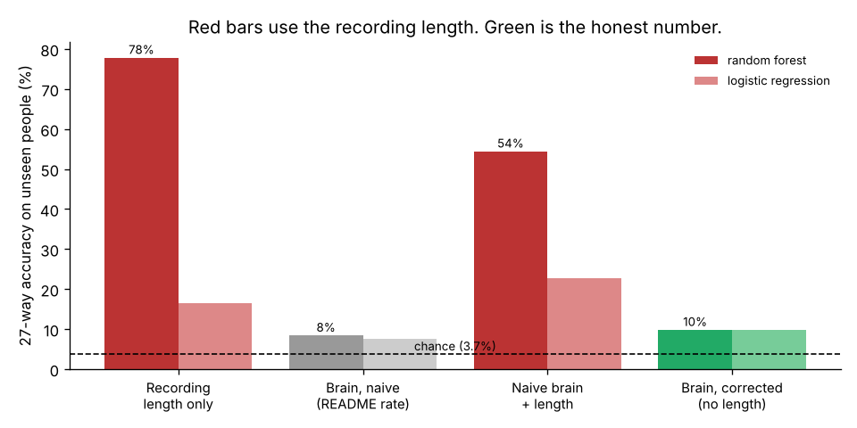
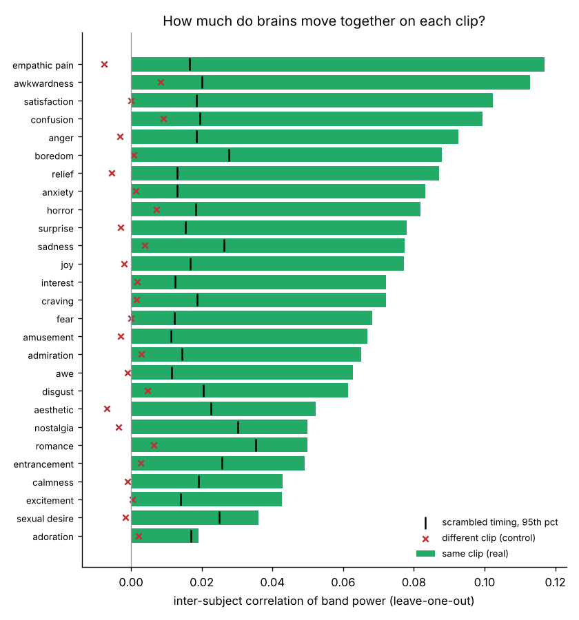
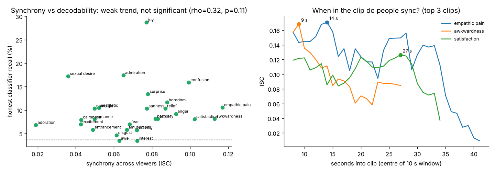

# EEGEmotions-27: checking the data before trusting it, then asking what the shared clips can tell us

## TL;DR

A random forest predicted the trial label with 77.8% accuracy on unseen participants using recording duration alone. The raw files also show evidence that 41 of 88 participants were recorded at 128 Hz. After correcting the rates and using the first 18 seconds of each trial, EEG bandpower reached 9.8% accuracy with access to each held-out participant's unlabeled batch. EEG bandpower also tracked the clip timeline across viewers, with average synchrony of 0.071 on the same clip and 0.001 across different clips.

## 1. Two problems I found before modelling anything

### The sampling rate is wrong for about half the people



The Emotiv headset filters out power-line noise at 50 and 60 Hz, so the spectrum has notches there.
For 41 people, those notches show up at exactly 100 and 120 Hz when you assume 256 Hz.
The twofold shift is consistent with a true sampling rate of 128 Hz. Those same 41 people also have recordings exactly half as long as everyone else's for the same clip.

The first clue was that recordings of the same clip fell into two groups with roughly a two-to-one ratio in sample counts. The notch locations provided a second check. Assuming 256 Hz for a 128 Hz recording doubles its apparent frequencies and moves a 10 Hz alpha rhythm into the apparent beta band.

**Fix:** `src/load_data.py` finds the notch in each file and decides the true rate from the data, not the README. Everyone is then put on a common 128 Hz grid.
After the fix, both groups show alpha at ~11 Hz and retained recordings cluster around their clip lengths:



### The emotion label is basically "which video"

Each emotion is one fixed clip, and each clip has its own length. So the length of the recording gives away the label.



| Inputs | Random forest | Logistic |
|---|---|---|
| Recording length only | 78% | 16% |
| Brain, naive (trust README, whole trial) | 8% | 8% |
| Naive EEG + length | 54% | 23% |
| **EEG, corrected rate, first 18 s** | **10%** | **10%** |

All numbers are 5-fold cross-validation **split by participant**, so the model is always tested on people it has never seen. Chance is 3.7%.

A high score on this dataset can come from trial duration. The fixed-window comparison removes direct access to the original sample count, but the EEG still comes from one clip per label. The model could pick up clip-specific visual or auditory responses. The benchmark also standardizes features using the unlabeled trials of each held-out participant as a batch and applies a duration filter based on the known clip label before splitting. The score is conditional on those choices.

Other checks:
- Training on the 256 Hz people and testing on the 128 Hz people was near chance with or without the fix (5.0% vs 6.1%), The comparison also changes the analysis window. The spectral evidence gives a more direct reason to correct the rate before interpreting the frequency bands.
- The supplied feature table's `Emo_Label_Ekman(6)` field was excluded from this analysis. The available mapping associates each of the 27 labels with multiple values in that field.

## 2. Turning the problem into the question: do brains sync up on the same clip?

Since viewers saw the same clips, their recordings can be aligned to the video timeline. Inter-subject correlation (ISC) measures how closely a viewer's bandpower time course tracks the average time course of the other viewers.

How (`src/synchrony.py`):
1. Band power over time (theta, alpha, beta) for each channel, in 1-second steps.
2. For each person, correlate with the average of everyone else on the same clip.
3. Cut 3 s off each end and remove slow drift.
4. Two controls: scrambled timing, and the same people watching a *different* clip.

An exploratory pass gave an ISC of roughly 0.12. After trimming the edges and removing slow drift together, the mean fell to 0.071 and remained above both controls. The change shows that the estimate is sensitive to preprocessing.



Results:
- All 27 clips sync above the scrambled-timing control after correcting for testing 27 clips (Benjamini-Hochberg FDR < 0.05).
- Synchrony ranges from 0.019 (adoration) to 0.117 (empathic pain), mean 0.071.
- Different-clip control: mean 0.001 (range -0.008 to 0.009). Basically zero, which is what it should be if synchrony comes from the video.
- Highest: empathic pain, awkwardness, satisfaction, confusion. Lowest: adoration, sexual desire, excitement, calmness.

Empathic pain and awkwardness both ranked high. Scene cuts, motion, and audio could all align responses across viewers, so the ranking describes the clips used here.



Synchrony vs. how decodable a clip is: Spearman rho = 0.32, p = 0.11 across the 27 clips. That's a weak trend, not a result.

Clips with more consistent responses might be easier to classify, but the estimate is noisy across 27 clips. Testing that idea would require more clips per emotion and measurements of video and audio features.

The largest values in the 10-second sliding windows were centered at roughly 14 s for empathic pain, 9 s for awkwardness, and 27 s for satisfaction. These windows give concrete timestamps for comparing the EEG peaks with scene cuts or audio changes.

Frontal electrodes (AF3, AF4, F7, F8) averaged 0.110. Posterior electrodes (P7, O1, O2, P8) averaged 0.050 and exceeded the circular-shift control after correction in 24 of 27 clips. The posterior result shows that the effect extends beyond the frontal electrodes. To test how much comes from eye activity, repeat the analysis with eye tracking or EOG and compare ISC before and after removing blink- and saccade-linked components.

## What to test next

- Annotate scene cuts, motion, and audio onsets and test whether they predict held-out synchrony peaks.
- Compare trial-by-trial decoding using training-fold scaling with the current batch-normalized benchmark. Repeat both analyses without filtering by label-specific duration.
- Use multiple clips per emotion and hold out entire clips to test whether decoding transfers to unfamiliar stimuli.

## How to run

```bash
git clone https://github.com/huytungst/EEGEmotions-27   # only eeg_raw/ is needed (~3.3 GB)
pip install -r requirements.txt
python src/load_data.py      <path>/EEGEmotions-27/eeg_raw data
python src/naive_features.py <path>/EEGEmotions-27/eeg_raw data
python src/sampling_rate_evidence.py <path>/EEGEmotions-27/eeg_raw
python src/check_fix.py
python src/benchmark.py && python src/plot_benchmark.py
python src/synchrony.py && python src/plot_synchrony.py
PYTHONPATH=src python src/region_check.py
```

Takes about 30–40 minutes on a 2-core laptop. `results/` has every number in the README.

## Files

| File | What it does |
|---|---|
| `src/load_data.py` | loads raw files, detects true sampling rate, resamples to 128 Hz |
| `src/naive_features.py` | spectra assuming 256 Hz for everyone (the baseline) |
| `src/sampling_rate_evidence.py` | figure 00, raw spectra showing the notch in the wrong place |
| `src/check_fix.py` | figure 01, confirms the fix |
| `src/benchmark.py`, `src/plot_benchmark.py` | duration baseline and EEG decoding, figure 02 |
| `src/synchrony.py`, `src/plot_synchrony.py` | EEG synchrony, figures 03-04 |
| `src/region_check.py` | frontal and posterior electrode comparison |
